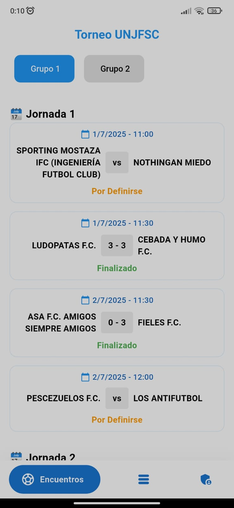
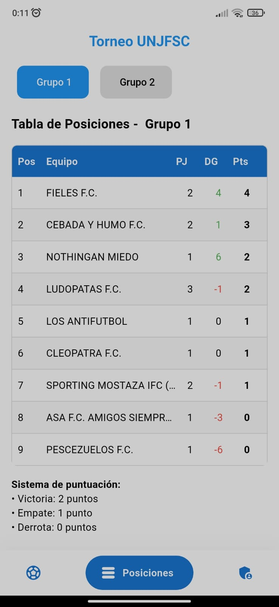
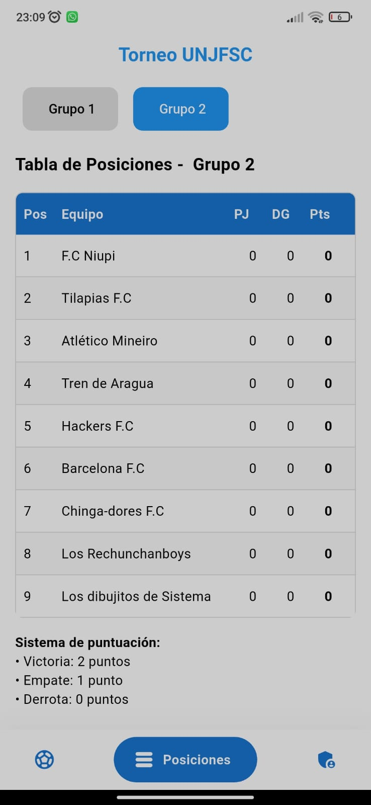
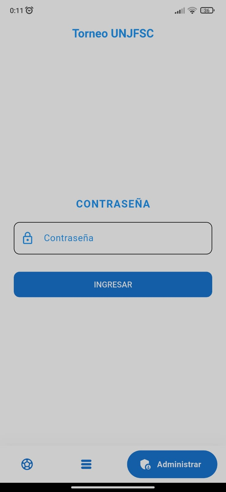

# Torneo UNJFSC

> A cross-platform Flutter application for managing and publishing university football tournaments.

Torneo UNJFSC is a cross-platform application for managing and publishing university football tournaments. Spectators can consult groups, scheduled matches, scores and standings, while tournament organizers can manage teams, generate round-robin fixtures, schedule matches and update results from an administrative panel.

The application is built as a Flutter client connected to a Supabase backend. It is prepared to run on Android, iOS, web, Windows, macOS and Linux.

### Features

- Public view of matches grouped by tournament round.
- Filtering of matches and standings by group.
- Display of scheduled dates, match status and scores.
- Automatic calculation of standings from completed matches.
- Statistics for games played, wins, draws, losses, goals and points.
- Pull-to-refresh for synchronizing tournament data.
- Password-protected administrative access.
- Creation and management of tournament groups.
- Registration and removal of teams within groups.
- Automatic round-robin fixture generation.
- Support for groups with an odd number of teams through scheduled byes.
- Match administration, including date, score and status updates.
- Automatic synchronization of public match and standings views after changes.

### Technologies used

- Flutter and Dart.
- Material Design and `google_nav_bar` for the user interface.
- Supabase and PostgreSQL for data persistence.
- `supabase_flutter` for backend communication.
- `flutter_dotenv` for environment-based configuration.
- `flutter_lints` for static analysis and code quality.
- Round-robin scheduling algorithm implemented in Dart.

 
---

## Español

Torneo UNJFSC es una aplicación multiplataforma para administrar y publicar torneos universitarios de fútbol. Los espectadores pueden consultar grupos, partidos programados, marcadores y tablas de posiciones, mientras que los organizadores pueden gestionar equipos, generar calendarios todos contra todos, programar partidos y actualizar resultados desde un panel administrativo.

La aplicación está construida con Flutter y conectada a un backend de Supabase. Está preparada para ejecutarse en Android, iOS, web, Windows, macOS y Linux.

### Funcionalidades

- Consulta pública de partidos agrupados por jornada.
- Filtrado de partidos y posiciones por grupo.
- Visualización de fechas programadas, estados y marcadores.
- Cálculo automático de posiciones a partir de partidos finalizados.
- Estadísticas de partidos jugados, victorias, empates, derrotas, goles y puntos.
- Actualización manual de datos mediante pull-to-refresh.
- Acceso administrativo protegido por contraseña.
- Creación y gestión de grupos del torneo.
- Registro y eliminación de equipos dentro de los grupos.
- Generación automática de calendarios todos contra todos.
- Soporte para grupos con cantidad impar de equipos mediante jornadas de descanso.
- Administración de partidos, fechas, marcadores y estados.
- Sincronización automática de las vistas públicas después de cambios administrativos.

### Tecnologías utilizadas

- Flutter y Dart.
- Material Design y `google_nav_bar` para la interfaz.
- Supabase y PostgreSQL para la persistencia de datos.
- `supabase_flutter` para la comunicación con el backend.
- `flutter_dotenv` para la configuración mediante variables de entorno.
- `flutter_lints` para análisis estático y calidad de código.
- Algoritmo de programación round-robin implementado en Dart.

